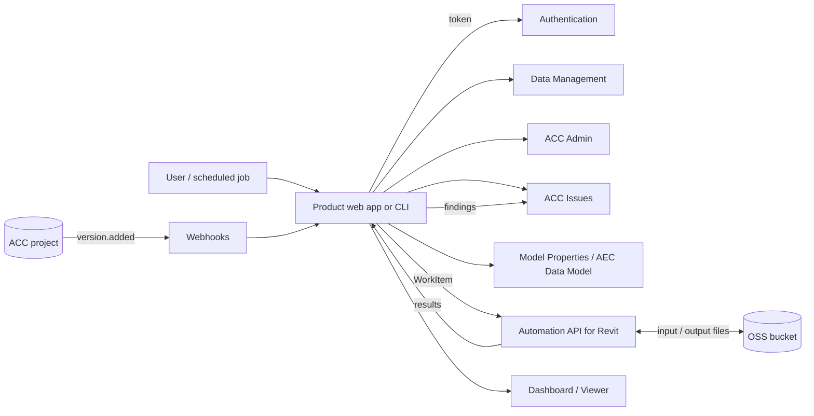

# APS Lab

Products for BIM delivery built on **Autodesk Platform Services (APS)**, the API layer behind
Autodesk Construction Cloud (ACC), BIM 360, Revit cloud models and the Autodesk Viewer.

This repository documents which APS APIs I use, what each product does with them, and the
patterns and pitfalls I have hit along the way. It is written for BIM managers, digital
delivery teams and developers who want to automate ACC and Revit work at portfolio scale.

> **Status:** active development. Products are listed in the [roadmap](#roadmap) with their
> current state.

---

## Contents

- [Why APS](#why-aps)
- [APIs used](#apis-used)
- [Products](#products)
- [Architecture](#architecture)
- [Authentication](#authentication)
- [Key endpoints](#key-endpoints)
- [Pitfalls and lessons learned](#pitfalls-and-lessons-learned)
- [Getting started](#getting-started)
- [Roadmap](#roadmap)
- [Resources](#resources)

---

## Why APS

Most BIM delivery work that is slow is slow because it is manual: setting up projects,
adding users, moving files between projects, checking models against standards, exporting
parameters, logging issues. ACC exposes nearly all of this through APS, which means it can
be scripted, scheduled and repeated across hundreds of projects with the same result every time.

---

## APIs used

| API | What it gives access to | Used for |
|---|---|---|
| **Authentication (OAuth 2.0)** | Access tokens: 2-legged (app), 3-legged (user), Secure Service Accounts | Every call |
| **Data Management** | Hubs, projects, folders, files, versions; file upload and download | File search, bulk transfer, folder setup |
| **ACC Admin** | Accounts, projects, project users, companies, roles | Project creation, user onboarding, audits |
| **ACC Issues** | Issues, issue types, root causes, comments | Logging QA/QC findings, design review dashboards |
| **Model Derivative** | Translating models (RVT, DWG, IFC, NWD…) for viewing; reading object trees and properties | Property extraction, viewer preparation |
| **Viewer SDK** | Browser-based 2D/3D viewer for translated models | Visual QA, dashboards linked to model elements |
| **Automation API** (Design Automation) | Running Revit, AutoCAD, Inventor and 3ds Max headlessly in Autodesk's cloud | Model checks, parameter export/import, batch PDF, file upgrades |
| **AEC Data Model** (GraphQL) | Granular element and property data from Revit cloud models without downloading them | LOI checks, cross-project queries |
| **Model Properties** | Indexed, queryable properties across ACC models, including diffs between versions | Compliance reporting, change tracking |
| **Webhooks** | Event notifications (file added, version created, issue changed…) | Triggering checks automatically on upload |
| **Object Storage Service (OSS)** | App-owned buckets for files | Staging inputs and outputs for Automation API jobs |

---

## Products

Each product lives in its own folder (or repository) with its own README.

### 1. ACC File Search & Push
Find ACC projects by site code, search and filter their files, and push a selection to a
folder in another project.
**APIs:** Authentication · Data Management · ACC Admin
**Demo:** [acc-file-search](https://github.com/uppalabhishek/acc-file-search) ([live demo](https://uppalabhishek.github.io/acc-file-search/))

### 2. BIM QA/QC Dashboard
Model compliance, LOI, LOD, MIDP delivery, clashes, design review issues and stakeholder
activity for a project, in one page.
**APIs:** Model Properties · AEC Data Model · ACC Issues · ACC Admin · Data Management
**Demo:** [qa-qc-dashboard](https://github.com/uppalabhishek/qa-qc-dashboard) ([live demo](https://uppalabhishek.github.io/qa-qc-dashboard/))

### 3. Automated Model Checker
When a new Revit version is uploaded to ACC, run standards checks (naming, shared
coordinates, classification, required parameters, warnings) in the cloud and log every
failure as an ACC Issue assigned to the model author.
**APIs:** Webhooks · Automation API for Revit · OSS · ACC Issues · Data Management

### 4. Project Setup Bot
Create ACC projects from a template spreadsheet: project details, folder structure,
permissions, and members with their roles and companies.
**APIs:** ACC Admin · Data Management

### 5. Parameter Exchange
Export Revit cloud model parameters to Excel, edit them in bulk, and write them back to the
model.
**APIs:** Automation API for Revit · Data Management · OSS

### 6. Device Placement in the Cloud
Run the placement logic behind [wap-designer](https://github.com/uppalabhishek/wap-designer)
directly against a Revit model: place wireless APs and other devices by rule and return an
updated model.
**APIs:** Automation API for Revit · Data Management · OSS

---

## Architecture



A typical automated flow:

1. Someone uploads a new model version to ACC.
2. A **webhook** notifies the app.
3. The app starts an **Automation API WorkItem** that opens the model in cloud Revit and runs the checks.
4. Results come back as JSON, and each failure becomes an **ACC Issue**.
5. The **dashboard** updates from Issues and Model Properties.

---

## Authentication

| Flow | Acts as | Use when |
|---|---|---|
| **2-legged** (client credentials) | The app itself | Server jobs, OSS, Model Derivative, Automation API, many admin reads |
| **3-legged** (authorization code) | A signed-in user | Anything that must respect the user's ACC permissions or be attributed to them (e.g. creating issues) |
| **Secure Service Account (SSA)** | A service user, without an interactive login | Scheduled or unattended jobs that need user context |

**Scopes used:** `data:read` `data:write` `data:create` `data:search` `account:read`
`account:write` `bucket:create` `bucket:read` `code:all` `viewables:read`

Request the smallest set each product needs. Tokens expire after about one hour, so cache
them and refresh before expiry rather than requesting one per call.

---

## Key endpoints

Base URL: `https://developer.api.autodesk.com`

| Task | Method and path |
|---|---|
| Get a token | `POST /authentication/v2/token` |
| List hubs | `GET /project/v1/hubs` |
| List projects in a hub | `GET /project/v1/hubs/{hubId}/projects` |
| Top folders of a project | `GET /project/v1/hubs/{hubId}/projects/{projectId}/topFolders` |
| Folder contents | `GET /data/v1/projects/{projectId}/folders/{folderId}/contents` |
| Search a folder tree | `GET /data/v1/projects/{projectId}/folders/{folderId}/search` |
| List account projects (ACC Admin) | `GET /construction/admin/v1/accounts/{accountId}/projects` |
| Create a project | `POST /construction/admin/v1/accounts/{accountId}/projects` |
| Project users | `GET /construction/admin/v1/projects/{projectId}/users` |
| Issues | `GET` / `POST /construction/issues/v1/projects/{projectId}/issues` |
| Translate a model | `POST /modelderivative/v2/designdata/job` |
| Translation status | `GET /modelderivative/v2/designdata/{urn}/manifest` |
| AEC Data Model query | `POST /aec/graphql` |
| Automation API | `/da/us-east/v3/appbundles` · `/activities` · `/workitems` |
| Create a webhook | `POST /webhooks/v1/systems/{system}/events/{event}/hooks` |

Check the [API reference](https://aps.autodesk.com/developer/documentation) before relying on
any path. APIs are versioned and some are regional.

---

## Pitfalls and lessons learned

- **Add the app to the ACC account first.** An account admin must add the APS app's Client ID
  under *Account Admin → Custom Integrations*. Otherwise calls fail with 403, even with a valid
  token.
- **The `b.` prefix.** Data Management uses IDs like `b.1a2b3c…` for hubs and projects. The ACC
  Admin and Issues APIs use the same ID **without** `b.`. Strip or add it when moving between
  the two.
- **Paginate everything.** Lists are paged (`limit` / `offset`, or `page[number]` in Data
  Management). A project with 5,000 files will not come back in one response.
- **Handle `429 Too Many Requests`.** Respect the `Retry-After` header and back off. Portfolio
  scripts hit rate limits quickly.
- **Uploads use signed S3 URLs.** Large files go through
  `/oss/v2/buckets/{bucketKey}/objects/{objectKey}/signeds3upload`, then a version is created
  in Data Management. It is a multi-step process, not a single POST.
- **Automation API is billed.** Processing time consumes Autodesk Flex tokens. Test your
  AppBundle locally with the
  [Revit debug tool](https://github.com/autodesk-platform-services/aps-automation-csharp-revit.local.debug.tool)
  before running it in the cloud, and keep jobs small.
- **Translation takes time.** Model Derivative jobs are asynchronous. Poll the manifest or use a
  webhook, and never assume a model is viewable immediately after upload.
- **Never commit secrets.** Keep `APS_CLIENT_ID` and `APS_CLIENT_SECRET` in a `.env` file that is
  listed in `.gitignore`.

---

## Getting started

1. Create an app at the [APS Developer Portal](https://aps.autodesk.com/myapps) and note the
   Client ID and Client Secret.
2. Ask your ACC account admin to add the Client ID under **Custom Integrations**.
3. Create a `.env` file in the product folder:

   ```env
   APS_CLIENT_ID=your-client-id
   APS_CLIENT_SECRET=your-client-secret
   APS_CALLBACK_URL=http://localhost:8080/api/auth/callback
   ```

4. Follow the README in the product's folder to install and run it.

---

## Roadmap

| Product | State |
|---|---|
| ACC File Search & Push | Demo (sample data) |
| BIM QA/QC Dashboard | Demo (sample data) |
| Automated Model Checker | Planned |
| Project Setup Bot | Planned |
| Parameter Exchange | Planned |
| Device Placement in the Cloud | Planned |

---

## Resources

**Official**
- [APS documentation](https://aps.autodesk.com/developer/documentation)
- [APS tutorials](https://aps.autodesk.com/tutorials)
- [APS pricing](https://aps.autodesk.com/pricing)
- [Autodesk sample repositories](https://github.com/autodesk-platform-services)

**Samples I learned from**
- [aps-hubs-browser-nodejs](https://github.com/autodesk-platform-services/aps-hubs-browser-nodejs): browsing hubs, projects and files
- [aps-bim360-project-setup](https://github.com/autodesk-platform-services/aps-bim360-project-setup): project and user setup from the command line
- [aps-checkmodels-createissues-revit](https://github.com/autodesk-platform-services/aps-checkmodels-createissues-revit): Automation API checks logged as issues
- [aps-revit-rcw-parameters-exchange](https://github.com/autodesk-platform-services/aps-revit-rcw-parameters-exchange): parameter round-trip through Excel
- [aps-design-automation-nodejs](https://github.com/autodesk-platform-services/aps-design-automation-nodejs): AppBundles, Activities and WorkItems explained
- [aps-design-automation-tools](https://github.com/autodesk-platform-services/aps-design-automation-tools): inspecting Automation API resources

**Community**
- [petrbroz/vscode-forge-tools](https://github.com/petrbroz/vscode-forge-tools): browse APS data from VS Code
- [chuongmep/aps-toolkit](https://github.com/chuongmep/aps-toolkit): BIM data extraction library

---

## Author

**Abhishek Uppal**: BIM standards and automation, architect by training.
[GitHub profile](https://github.com/uppalabhishek)

*Autodesk, Revit, ACC and BIM 360 are trademarks of Autodesk, Inc. This project is independent
and not affiliated with or endorsed by Autodesk.*
